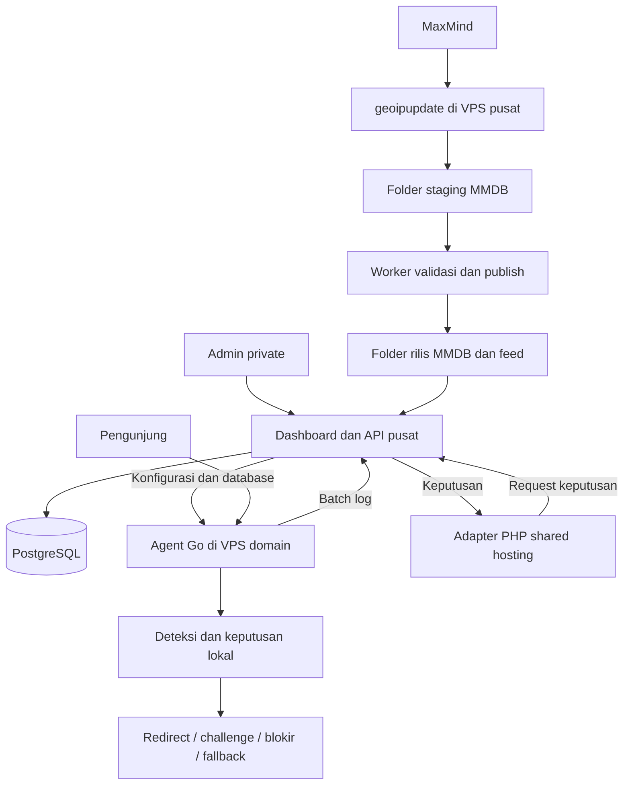

# Plan Shortlink Private

Tanggal: 10 Oktober 2026, Asia/Jakarta. Status: draf implementasi v1.

Spesifikasi layar dan alur pengguna: [UI_UX.md](UI_UX.md). Pembagian fase/batch dan hasil review: [PHASES.md](PHASES.md). Kedua dokumen menjadi acuan implementasi bersama plan ini.

## 1. Keputusan arsitektur

Gunakan model hybrid: pusat mengelola seluruh konfigurasi dan laporan; agent VPS melakukan deteksi serta redirect lokal. Agent shared hosting yang tidak bisa menjalankan Go memakai adapter PHP dan API keputusan pusat.

Asumsi kapasitas awal: 10–50 klik/detik normal, 100–300 klik/detik saat ramai, dihitung sebagai total seluruh domain. Jika angka tersebut ternyata per domain, kapasitas pusat dan penyimpanan harus dihitung ulang berdasarkan jumlah domain aktif.

| Pilihan | Kelebihan | Konsekuensi | Penggunaan |
| --- | --- | --- | --- |
| Semua keputusan lewat API pusat | Agent sederhana, aturan langsung berlaku di pusat | Setiap klik bergantung jaringan dan ketersediaan pusat; pusat menerima seluruh beban keputusan | Shared hosting terbatas |
| Semua keputusan lokal | Redirect cepat, bisa berjalan saat pusat putus | Agent perlu database dan mesin aturan; perubahan menunggu sinkronisasi | Agent VPS |
| Hybrid | Pengelolaan pusat dengan jalur redirect lokal; adapter hosting tetap tersedia | Dua mode harus memakai kontrak keputusan yang konsisten | Pilihan project |

300 klik/detik tidak otomatis mengharuskan banyak microservice. Mulai dari satu aplikasi API Go dengan modul terpisah, worker, PostgreSQL, dan agent Go. Pisahkan service atau tambah komponen setelah pengukuran menunjukkan kebutuhan.

Worker pusat dapat menyinkronkan log setelah redirect, tetapi tidak bisa menentukan ulang redirect yang sudah diterima pengunjung. Pada mode API, keputusan harus diterima sebelum agent mengirim respons redirect.



## 2. Ruang lingkup private

- Dashboard admin: login, 2FA, manajemen domain/link, aturan, statistik, simulator, audit, rollback.
- Domain: registrasi kepemilikan, pemasangan agent, status TLS, heartbeat, versi konfigurasi/database, pencabutan kredensial.
- Link: slug unik per domain, tujuan utama, fallback, status, masa aktif, label/campaign, query parameter dengan allowlist.
- Tujuan link yang sudah published bisa diedit tanpa mengganti domain, slug, ID atau histori traffic. Simpan sebagai draft terpisah, lalu publish revision baru untuk diterapkan agent.
- Aturan: negara, perangkat, OS/browser, IP/CIDR/ASN, kategori bot, reputasi IP, waktu, dan batas request.
- Tindakan: redirect 302, challenge, blokir, atau fallback yang ditentukan admin.
- Semua domain dan server merupakan instalasi yang kita kelola; billing dan pendaftaran pelanggan tidak masuk v1.

## 3. Instalasi agent dan jalur request

### Dua cara instalasi: CLI VPS dan ZIP PHP

Agent domain mempunyai dua jalur pemasangan v1: installer CLI untuk VPS memakai Docker Compose, dan ZIP PHP beserta file pendukung untuk hosting tanpa Docker. Installer VPS menyiapkan layanan secara otomatis; pengguna cukup menjalankan installer dan memasukkan token/key registrasi dari dashboard.

| Cara instalasi | Target | Paket download | Alur |
| --- | --- | --- | --- |
| CLI VPS | VPS Linux bersih atau VPS dengan Docker, akses SSH dan hak instalasi | Installer, konfigurasi Compose, image agent Go | Jalankan installer, masukkan token/key; installer melakukan enrollment, konfigurasi, download MMDB, dan start layanan |
| ZIP PHP | Hosting PHP yang memenuhi prasyarat, tanpa Docker | ZIP adapter PHP, file routing, contoh konfigurasi dan petunjuk | Upload/ekstrak, atur public/private path, masukkan token/key melalui setup, lalu verifikasi koneksi API |

CLI/ZIP adalah cara memasang; `local` dan `api` adalah mode pemrosesan traffic. CLI VPS menjalankan agent Go mode lokal dalam container; ZIP PHP menjalankan adapter mode API melalui runtime PHP hosting. Instalasi binary Go native secara manual bukan deliverable wajib v1.

Target image agent awal Linux `amd64` dan `arm64`. Rilis installer/ZIP memuat versi, checksum, manifest bertanda tangan, tutorial, serta konfigurasi tanpa rahasia. MMDB diunduh terpisah dari pusat setelah enrollment. Verifikasi manifest memakai identitas/kunci pusat yang diperoleh saat provisioning; checksum dari sumber yang sama saja tidak menjadi bukti keaslian.

Installer CLI memeriksa OS/arsitektur, disk, port, DNS, serta Docker/Compose yang tersedia. Pada VPS bersih dengan OS yang didukung, installer memasang Docker/Compose; pada VPS yang sudah memiliki Docker, gunakan instalasi yang tersedia. Installer kemudian memvalidasi token/key, mengambil konfigurasi domain dari pusat, menyiapkan direktori persistent, menarik image versi/digest yang ditetapkan, mengunduh MMDB, mengaktifkan layanan dengan restart policy, dan memeriksa kesehatan agent serta HTTPS.

URL pusat dan identitas verifikasinya disertakan dalam konfigurasi bootstrap atau perintah download yang dibuat dashboard; domain target diperoleh dari token yang sudah dikaitkan ke domain. Dengan begitu, input normal saat install cukup token/key. URL tetap bisa diganti melalui konfigurasi saat pusat berpindah. Gunakan token enrollment melalui prompt atau file terlindungi, lalu tukar menjadi kredensial agent; hindari token di command history atau argumen proses.

Installer menyediakan pemeriksaan awal dan bisa dijalankan ulang tanpa menghapus data. Pada VPS yang sudah melayani aplikasi lain, deteksi konflik port/reverse proxy dan tampilkan penyesuaian yang diperlukan. Alur otomatis penuh mensyaratkan OS didukung, hak instalasi, DNS domain yang benar, akses jaringan, serta port atau reverse proxy yang sesuai; token saja tidak dapat memperbaiki prasyarat infrastruktur yang belum terpenuhi.

Path default instalasi CLI VPS:

```text
/opt/shortlink-agent/compose.yml           # layanan agent dan reverse proxy
/etc/shortlink-agent/agent.env             # konfigurasi dan referensi kredensial
/var/lib/shortlink-agent/                  # bind mount MMDB, state, dan antrean
```

Path dapat diubah melalui opsi installer dan konfigurasi. Agent di container berjalan sebagai user non-root, dengan direktori data yang diberi izin sesuai UID layanan. Installer menyiapkan reverse proxy dan HTTPS pada VPS bersih; untuk reverse proxy yang sudah ada, sediakan konfigurasi integrasi tanpa menimpa konfigurasi layanan lain.

ZIP PHP memakai direktori public untuk entrypoint/routing dan direktori private terpisah untuk konfigurasi, kredensial, dan data yang diperlukan. Setup menggunakan alamat pusat dari bootstrap paket dan token/key dari pengguna, lalu menyimpan kredensial hasil enrollment di direktori private. Setelah berhasil, setup dikunci untuk mencegah registrasi ulang tanpa otorisasi. Jika hosting tidak dapat melindungi direktori private, prasyarat instalasi belum terpenuhi.

### Download dan tutorial

Dashboard menyediakan halaman download agent: pilih CLI VPS atau ZIP PHP, pilih versi/domain, kemudian tampilkan tutorial yang sesuai dengan URL pusat saat ini. Installer menentukan arsitektur VPS secara otomatis. URL pusat boleh disertakan dalam bootstrap paket yang dihasilkan dashboard dan tetap dapat diedit; tidak ditanam permanen dalam aplikasi.

Artifact download tersedia dari server pusat lewat HTTPS. Akses private memakai sesi admin atau URL bertanda tangan dengan masa berlaku pendek; setelah enrollment, download oleh CLI dapat memakai kredensial agent sesuai cakupan. Jangan memasukkan kredensial agent/MaxMind ke arsip yang dibagikan atau meneruskan kredensial pusat ke origin penyimpanan lain.

Dokumentasi implementasi yang wajib disediakan bersama rilis:

- Tutorial CLI VPS: prasyarat, download/verifikasi installer, jalankan install, masukkan token/key, pemasangan atau penggunaan Docker yang tersedia, DNS/HTTPS, dan health check.
- Tutorial ZIP PHP: prasyarat hosting, upload ZIP dan file pendukung, public/private path, rewrite, setup token/key, konfigurasi API, dan fallback.
- Tutorial operasi: update versi image/paket, rollback dengan state yang kompatibel, ganti URL pusat, serta uninstall dengan pilihan mempertahankan data.

Download/installer/tutorial tersebut merupakan deliverable implementasi; belum tersedia pada tahap plan. Pengujian mencakup CLI pada VPS bersih, CLI pada VPS dengan Docker, dan ZIP PHP pada hosting tanpa Docker. Update image/paket tidak menghapus konfigurasi, MMDB, atau antrean event.

### Agent VPS: mode lokal sebagai default

1. Validasi host terhadap domain terdaftar dan cari slug pada snapshot konfigurasi lokal.
2. Tentukan IP asli dari koneksi langsung atau rantai proxy terpercaya; dukung IPv4/IPv6.
3. Baca negara/kota/ASN dari MMDB lokal, parse perangkat, cek crawler/feed IP dan rate limit.
4. Evaluasi snapshot aturan yang sudah dikompilasi; tidak melakukan query PostgreSQL pusat per klik.
5. Kirim hasil. Redirect dinamis menggunakan 302 dan `Cache-Control: no-store`; cegah loop redirect.
6. Masukkan event ke antrean lokal yang persisten, lalu kirim batch ke pusat.

SQLite dipakai untuk konfigurasi dan antrean lokal, dengan penulis antrean khusus, transaksi batch, dan ukuran buffer terbatas. Hot path membaca konfigurasi di memori. Durabilitas sebelum/sesudah respons harus diukur; v1 boleh mengakui kehilangan sejumlah event yang masih di buffer saat crash, dengan metrik yang terlihat.

### Shared hosting: mode API

Adapter PHP mengirim IP yang sudah ditentukan dari proxy terpercaya, domain/slug, sinyal header terbatas, waktu, dan event ID ke API pusat melalui HTTPS. Pusat memvalidasi kredensial serta cakupan domain, melakukan deteksi, lalu mengembalikan keputusan. IP koneksi API adalah IP adapter, bukan IP pengunjung; keduanya dipisahkan saat pemrosesan. IP penuh/UA mentah tidak dipersist dalam log event.

Event keputusan dicatat sekali di pusat. Jika perlu membedakan keputusan dengan respons yang dikirim adapter, adapter dapat mengirim acknowledgement dengan ID yang sama. Sistem tidak mengklaim bahwa respons redirect berarti pengunjung berhasil membuka situs tujuan.

Adapter memerlukan PHP dengan HTTPS outbound/cURL, kemampuan rewrite/routing, dan konfigurasi rahasia di luar web root. Dukungan SQLite, cron, dan MMDB bervariasi antar hosting. Docker/Go daemon tidak diasumsikan tersedia di shared hosting.

Jika API timeout: gunakan fallback lokal yang dipublikasikan admin, atau 503 apabila kebijakan mewajibkan pemeriksaan pusat. Jangan otomatis mengizinkan semua traffic. Mesin aturan PHP lengkap dan distribusi MMDB ke PHP merupakan perluasan setelah mode API stabil.

## 4. GeoLite di pusat dan distribusi ke agent

Gunakan `GeoLite2-Country.mmdb`, `GeoLite2-City.mmdb`, dan `GeoLite2-ASN.mmdb`. Ekstensi yang benar adalah `.mmdb`. Country dipakai untuk routing negara, City untuk laporan lokasi perkiraan, ASN untuk jaringan/operator. Negara yang tidak diketahui menjadi `unknown` dengan tindakan eksplisit.

Updater resmi `geoipupdate` hanya berjalan di pusat. Account ID dan license key MaxMind tetap di pusat. Agent mengunduh database melalui API pusat dengan kredensial agent sendiri. Konfigurasi updater dan path Docker didasarkan pada [dokumentasi resmi geoipupdate](https://github.com/maxmind/geoipupdate/blob/main/doc/docker.md).

GeoLite Country/City/ASN tidak menyediakan flag VPN/proxy seperti produk Anonymous IP. ASN hosting juga bukan bukti pasti VPN atau bot. [Struktur database lokasi](https://dev.maxmind.com/geoip/docs/databases/city-and-country/) dan [produk Anonymous IP terpisah](https://dev.maxmind.com/geoip/docs/databases/anonymous-ip/).

### Folder dan volume

```text
<project>/data/geoip/
  staging/                         # output geoipupdate; belum dibagikan
    GeoLite2-Country.mmdb
    GeoLite2-City.mmdb
    GeoLite2-ASN.mmdb
  releases/<release-id>/            # salinan rilis yang sudah divalidasi
    GeoLite2-Country.mmdb
    GeoLite2-City.mmdb
    GeoLite2-ASN.mmdb
    manifest.json
  current.json                     # pointer ke rilis aktif, diganti atomik

<agent-data>/geoip/releases/<release-id>/
<agent-data>/geoip/current.json
<agent-data>/state/agent.db
```

Folder `data/` tidak masuk Git, tidak disajikan sebagai web root, dan tidak dimasukkan ke image build. Mount direktori agar pergantian file tetap terlihat; hindari bind mount satu file MMDB yang diganti melalui rename.

| Service | Path host | Path container | Akses |
| --- | --- | --- | --- |
| geoipupdate | `<project>/data/geoip/staging` | `/usr/share/GeoIP` | Baca/tulis |
| Publisher pusat | `<project>/data/geoip` | `/var/lib/shortlink/geoip` | Baca/tulis |
| API pusat | `<project>/data/geoip` | `/var/lib/shortlink/geoip` | Read-only |
| Agent Go | `<agent-data>` | `/var/lib/shortlink-agent` | Baca/tulis untuk download dan state |

Variabel rencana aplikasi: `GEOIP_ROOT=/var/lib/shortlink/geoip`, `AGENT_DATA_DIR=/var/lib/shortlink-agent`, `GEOIP_REQUIRED=true`. Path host dapat relatif terhadap Compose atau absolut sesuai VPS. Container memakai path internal yang tetap.

Pada instalasi CLI VPS, installer memetakan direktori persistent host ke `AGENT_DATA_DIR` dalam container. Struktur rilis MMDB, verifikasi manifest, dan sinkronisasinya tetap sama. ZIP PHP mode API memakai hasil lookup pusat dan tidak wajib mengunduh MMDB.

Contoh updater sudah disediakan di `deploy/compose.geoip.yml`. Dari root project:

```sh
cp deploy/.env.geoip.example deploy/.env.geoip
# Edit deploy/.env.geoip dengan kredensial MaxMind dan path host.
mkdir -p data/geoip/staging
docker compose --env-file deploy/.env.geoip -f deploy/compose.geoip.yml config --quiet
docker compose --env-file deploy/.env.geoip -f deploy/compose.geoip.yml up -d
```

Perintah di atas memasang updater. Publisher/API download dan aktivasi agent tersedia B07; lihat [GEOIP.md](GEOIP.md). Image contoh menggunakan tag `latest`; produksi harus memakai versi/digest yang sudah diuji. Interval cek awal 24 jam; hanya publish ketika konten database berubah. Rahasia MaxMind dapat dipindahkan ke Docker secrets melalui opsi `_FILE` yang didukung updater.

### Siklus publish dan download

1. Updater mengunduh ke staging.
2. Publisher menyalin kandidat ke rilis sementara dan memeriksa kestabilan sumber, metadata MMDB, edition, serta lookup IPv4/IPv6. Jangan publish file ketika masih berubah.
3. Buat manifest: release ID, edition, build epoch, waktu publish, ukuran, SHA-256 setiap file, atribusi dan informasi lisensi. Tanda tangani manifest dengan kunci pusat.
4. Publish seluruh rilis secara atomik dengan mengganti pointer aktif setelah semua file valid.
5. Agent memeriksa manifest berkala dengan ETag; awalnya setiap 6 jam dengan jitter, serta saat instalasi. Konfigurasi link diperiksa lebih sering.
6. Agent mengunduh rilis ke direktori sementara, memeriksa signature, checksum, ukuran, tipe database, dan membuka reader untuk pengujian.
7. Agent mengganti pointer dan reader aktif secara atomik. Reader lama ditutup setelah request yang menggunakannya selesai.
8. Laporkan versi aktif ke dashboard; unduhan gagal mempertahankan rilis lama yang masih boleh dipakai. Instalasi pertama tidak dinyatakan siap sebelum data wajib tersedia.

Gunakan endpoint authenticated dengan edition dan release ID yang divalidasi; jangan menerima path file bebas dari request. Berikan ETag, pembatasan unduhan per agent, streaming file, dan retry dengan backoff/jitter. Checksum mendeteksi kerusakan; keaslian berasal dari HTTPS dan signature manifest.

Sertakan atribusi MaxMind dan pemberitahuan lisensi dalam paket/manifest serta dokumentasi. Penggunaan/distribusi mengikuti [GeoLite EULA](https://www.maxmind.com/en/geolite/eula), termasuk penghapusan versi lama dalam 30 hari setelah rilis pembaruan. Cleanup mencakup pusat, agent, dan backup MMDB; backup konfigurasi cukup menyimpan referensi versi. Dashboard memperingatkan agent tertinggal. Versi yang diketahui melewati batas tidak digunakan lagi: agent beralih ke kebijakan `geo_unavailable`. Paket agent publik tidak membundel database atau license key.

## 5. Identitas pusat dan pergantian domain

Alamat pusat dan kredensial merupakan dua hal berbeda. Agent harus mempunyai keduanya, tanpa hostname yang ditanam permanen di binary:

```dotenv
CONTROL_PLANE_URL=https://control.example.com
CONTROL_PLANE_FALLBACK_URLS=https://control-backup.example.net
ASSET_BASE_URL=https://control.example.com
AGENT_DOMAIN=go.example.org
AGENT_MODE=local
AGENT_DATA_DIR=/var/lib/shortlink-agent
ENROLLMENT_TOKEN=replace-on-first-registration
```

Token enrollment sekali pakai ditukar menjadi agent ID dan kredensial unik yang disimpan lokal di luar web root. `ASSET_BASE_URL` default mengikuti pusat dan boleh terpisah untuk file. Kredensial tidak dikirim dalam query URL.

Saat migrasi terencana:

1. Siapkan pusat baru dengan data, kunci penandatanganan, kredensial agent, serta sertifikat HTTPS yang benar.
2. Pusat lama menerbitkan konfigurasi endpoint baru yang ditandatangani, dengan revision meningkat dan waktu berlaku.
3. Agent memvalidasi identitas pusat baru, mencoba endpoint baru, kemudian menyimpan alamatnya. Batasi perpindahan ke origin yang telah disetujui lewat konfigurasi bertanda tangan.
4. Pertahankan endpoint lama selama masa transisi dan pantau acknowledgement semua agent.
5. Agent offline dapat diperbaiki lewat penggantian konfigurasi URL lokal dan reconnect dengan kredensial yang tetap valid.

Jika domain lama hilang sebelum agent menerima alamat baru, token tidak dapat menemukan server baru sendiri. Sediakan fallback URL sejak instalasi atau lakukan perubahan URL lokal. DNS stabil untuk alamat control dapat mengurangi migrasi, tetapi tidak menggantikan mekanisme tersebut.

Client tidak boleh meneruskan Authorization secara otomatis ke origin berbeda lewat redirect HTTP. Download/migrasi harus memvalidasi origin tujuan terlebih dahulu. Jangan mematikan validasi TLS untuk menyelesaikan perpindahan domain.

## 6. Bot, crawler, dan proxy dengan komponen gratis

| Komponen | Kandidat sumber | Fungsi dan batas |
| --- | --- | --- |
| Reader MMDB Go | [oschwald/geoip2-golang](https://github.com/oschwald/geoip2-golang) | Membaca GeoLite lokal; reader dipakai ulang, bukan dibuka setiap klik |
| Parser perangkat | [ua-parser/uap-go](https://github.com/ua-parser/uap-go) | Browser/OS/device dari UA; cache terbatas untuk UA berulang |
| Deteksi crawler Go | [x-way/crawlerdetect](https://github.com/x-way/crawlerdetect) | Pola crawler yang dikenal; UA palsu tetap bisa lolos |
| Deteksi crawler PHP | [JayBizzle/Crawler-Detect](https://github.com/JayBizzle/Crawler-Detect) | Kandidat untuk adapter hosting; sinkronisasi pola antar mode perlu diuji |
| Reputasi IP | [stamparm/ipsum](https://github.com/stamparm/ipsum) | Feed IP mencurigakan dengan hit count; bukan database seluruh proxy/VPN |
| Tor | [Tor Project exit list](https://check.torproject.org/torbulkexitlist) | Sinyal exit Tor, bukan cakupan semua anonymizer; cakupan IPv4/IPv6 harus diperiksa |
| Challenge opsional | [Cloudflare Turnstile](https://developers.cloudflare.com/turnstile/plans/) | Ada paket gratis dengan batas konfigurasi; memerlukan layanan eksternal dan validasi token server-side |

Pilihan awal: GeoLite + parser UA + crawlerdetect + rate limit lokal. Feed Tor/reputasi menjadi sinyal tambahan setelah import, lisensi sumber, freshness, dan false positive diperiksa. Nama provider VPN atau deteksi residential proxy yang lengkap tidak dijanjikan pada paket gratis.

### Klasifikasi perangkat, OS, dan browser

Jenis perangkat dan OS adalah dua dimensi terpisah: `mobile/tablet/desktop/unknown` dan `ios/android/windows/macos/linux/chromeos/other/unknown`. Kelompok `ios` mencakup iOS/iPadOS yang berhasil dikenali; iPhone biasanya mobile dan iPad tablet. Safari tidak otomatis berarti iOS karena juga tersedia di macOS. `other` berarti hasil dikenali di luar kelompok utama; `unknown` berarti tidak berhasil dikenali. GeoLite tetap menjadi sumber negara, bukan sumber OS/perangkat.

Gunakan kandidat uap-go yang sudah ada untuk normalisasi OS, browser, dan family perangkat pada B08; tidak perlu parser tambahan pada frontend. Browser menjadi filter opsional terpisah (Chrome, Safari, Firefox, Edge, Samsung Internet, Opera, other, unknown). Versi OS/browser serta merek/model seperti Apple/iPhone hanya menjadi metadata bila ada bukti cukup; jika tidak tersedia simpan null. Model iPhone spesifik tidak dijanjikan. Mode PHP mengirim sinyal ke pusat dan memakai hasil normalisasi Go yang sama.

UA dan Client Hints yang diizinkan menjadi masukan parser bila tersedia. Detail dapat dibatasi oleh [user-agent reduction](https://developer.mozilla.org/en-US/docs/Web/HTTP/Guides/User-agent_reduction) dan dukungan [Client Hints](https://developer.mozilla.org/en-US/docs/Web/API/User-Agent_Client_Hints_API). Tidak menambah request JavaScript per redirect demi memperoleh model. Cache dibatasi ukuran/TTL, dengan key UA + hints relevan + versi parser; versi parser masuk metadata diagnosis saat backend dibangun. UA/hints dapat dipalsukan sehingga bukan bukti identitas perangkat atau manusia.

Pusat mengambil feed di background, memvalidasi format/ukuran dan perubahan mencurigakan, lalu mendistribusikan snapshot ke agent. Lookup IP memakai set/CIDR index di memori; tidak melakukan request GitHub, reverse DNS, atau API gratis setiap klik. Benchmark library dan ukuran cache menentukan kecepatan nyata; belum ada hasil benchmark project.

Status deteksi dipisahkan: `known_bot`, `suspected_automation`, `tor_exit`, `reputation_flag`, `proxy_unknown`. Tidak ditemukan dalam feed berarti tidak diketahui, bukan terbukti bebas proxy. Untuk deteksi VPN/proxy yang lebih lengkap, sediakan interface provider tambahan agar layanan/data berbayar bisa ditambahkan kemudian.

Mulai aturan risiko dalam mode observasi. UA crawler saja tidak membuktikan identitas crawler resmi; verifikasi rentang IP dari sumber resmi bila akan memberi pengecualian. Pisahkan crawler pencarian, link preview, dan bot lain. Jangan mengandalkan `robots.txt` sebagai kontrol akses.

Challenge hanya untuk request berisiko. Setelah sukses, gunakan cookie bertanda tangan dengan TTL dan cakupan domain. Kegagalan JavaScript bukan bukti tunggal bot; browser aplikasi dan pengguna tanpa JS memiliki kebijakan eksplisit. Rate limit per IP harus mempertimbangkan jaringan NAT dan memakai batas burst.

Rate limit lokal berlaku per agent. Untuk batas global lintas agent atau kuota link yang harus tepat, diperlukan koordinasi pusat; itu merupakan jalur khusus, bukan lookup pusat untuk semua klik.

## 7. Aturan dan konsistensi

Hierarki global/domain/link menghasilkan satu snapshot efektif. Simpan prioritas eksplisit: denylist wajib, pengecualian yang diizinkan, pemeriksaan risiko, routing, lalu default. First-match menentukan hasil; scope lebih spesifik tidak diam-diam meniadakan blokir wajib global.

Dashboard mengikat rule set global ke semua link, rule set domain ke semua link pada domain itu, dan rule set link ke satu shortlink. Simulator menerima link ID sehingga konteks domain dan tujuan tepat. Field scope/scopeId berada pada rule set; UI boleh meratakannya sebagai ScopedRule untuk menampilkan binding setiap baris.

Aturan redirect/fallback mempunyai destinationSource `link` atau `custom`. `link` mengambil tujuan published shortlink saat evaluasi; `custom` memakai URL khusus aturan yang tidak berubah ketika tujuan dasar shortlink diedit. Matching blokir global dengan mandatory=true dievaluasi sebelum routing; prioritas unik per rule set dan tie-break lintas scope deterministik (link, domain, global, lalu ID).

Kondisi negara, jenis perangkat, OS, browser, dan risiko digabung dengan AND. Setiap dimensi mempunyai wildcard semua; unknown hanya cocok dengan wildcard atau kondisi unknown eksplisit. Contoh routing semua iPhone/iPad: OS iOS, perangkat semua; routing iPhone saja memakai iOS + mobile tanpa menjanjikan deteksi model hardware. Merek/model hanya ditampilkan dalam log v1, belum menjadi syarat aturan. Kebijakan lama tanpa OS/browser dinormalisasi ke wildcard saat backend menerima/mengompilasi konfigurasi.

Setiap keputusan memuat rule ID, reason code, action, config revision, geo release, dan feed version. Simulator memakai mesin aturan Go yang sama dengan agent dan API. Contoh negara/perangkat unknown menjadi bagian pengujian.

Agent memeriksa konfigurasi setiap 15–30 detik dengan ETag dan jitter; hanya menerima snapshot lengkap yang valid, kemudian swap atomik. Dashboard menampilkan applied revision per agent. Link yang dicabut belum tentu berhenti pada agent offline: gunakan lease konfigurasi awal 24 jam yang dapat diperketat per domain. Lease kedaluwarsa menjalankan fallback/503 sesuai kebijakan.

## 8. API dan model data awal

| Endpoint rencana | Fungsi |
| --- | --- |
| `POST /v1/agents/enroll` | Registrasi dengan token sekali pakai |
| `POST /v1/agents/heartbeat` | Status, revision, versi MMDB, antrean |
| `GET /v1/agents/config` | Snapshot konfigurasi milik agent dengan ETag |
| `GET /v1/assets/geoip/manifest` | Manifest rilis GeoLite aktif |
| `GET /v1/assets/geoip/releases/{release}/{edition}` | Download MMDB untuk agent terotorisasi |
| `GET /v1/assets/feeds/manifest` | Versi feed reputasi/Tor |
| `GET /v1/assets/agent/manifest` | Manifest versi installer, referensi image agent, dan ZIP PHP |
| `GET /v1/assets/agent/releases/{version}/{artifact}` | Download artifact instalasi yang diizinkan |
| `POST /v1/events/batch` | Ingest batch event idempotent |
| `POST /v1/decisions` | Keputusan pusat untuk adapter mode API |
| `POST /v1/admin/rules/simulate` | Simulator admin |

Entitas awal: admin_users, domains, agents, links, rule_sets, config_revisions, geo_releases, feed_releases, traffic_events, traffic_aggregates, audit_logs. Event unik berdasarkan `(agent_id, event_id)`; batch diberi batas jumlah/byte.

Agent hanya mengakses domain dan aset yang ditetapkan. Pemegang kredensial agent dapat mengirim sinyal pengunjung, sehingga pusat mencatat sumber agent dan membatasi request; data tersebut tidak dianggap berasal dari browser terpercaya. Dashboard private, autentikasi admin, dan API agent memakai kontrol akses berbeda.

## 9. Log, penyimpanan, dan worker

### Penyimpanan aset dan opsi Bunny

Tahap private memakai filesystem VPS pusat untuk installer/ZIP PHP, manifest, MMDB, serta feed. Image agent didistribusikan melalui container registry dengan akses pull yang disiapkan installer; token enrollment tidak otomatis menjadi kredensial registry. Jika registry private digunakan, pusat menyediakan kredensial pull terbatas sesuai konfigurasi deployment. Tidak diperlukan bucket S3 untuk memproses klik; database traffic tetap PostgreSQL. Kebutuhan download mengikuti jumlah instalasi agent dan frekuensi pembaruan, bukan jumlah klik pengunjung.

User mempunyai layanan Bunny yang dapat dipertimbangkan untuk penyimpanan kompatibel S3. Integrasi ini ditunda sampai distribusi file membebani bandwidth/disk pusat, jumlah agent bertambah, atau diperlukan penyimpanan aset terpisah. Sebelum integrasi, verifikasi endpoint dan kemampuan akun Bunny yang sebenarnya, termasuk akses private dan dukungan URL download sementara.

Modul distribusi aset memakai interface penyimpanan dengan implementasi filesystem terlebih dahulu. Implementasi S3-compatible dapat ditambahkan kemudian melalui konfigurasi endpoint, bucket, region bila diperlukan, dan referensi secret. `ASSET_BASE_URL` dapat terpisah dari API pusat; manifest tetap mengidentifikasi versi, ukuran, checksum, dan origin download yang diizinkan.

Jika backend bucket digunakan, pusat tetap mengatur otorisasi dan penerbitan manifest. Agent mengunduh lewat URL sementara yang didukung provider atau streaming proxy pusat. Kredensial bucket hanya disimpan di pusat; agent tidak memerlukan S3 access key. Prefix/cache dan penghapusan versi MMDB lama harus mengikuti siklus rilis serta retensi yang sama. Keputusan redirect lokal tidak bergantung pada bucket.

### Log traffic

- Agent Go mengirim batch awal 100–500 event atau setiap 1–2 detik, mana yang lebih dahulu.
- Pusat mengakui batch setelah event tersimpan durable. Retry memakai ID tetap agar tidak menggandakan statistik.
- Worker membuat agregat per menit/jam, domain/link/negara/device/action/reason; raw event dipartisi harian di PostgreSQL.
- Retensi awal raw event 7 hari dan agregat 90 hari, configurable. IP lengkap hanya bila diperlukan untuk investigasi, dengan akses admin dan retensi terbatas; estimasi unik dapat memakai HMAC dengan rotasi salt.
- Antrean agent diberi batas byte/umur, disk monitoring, dan metrik dropped events. Pilihan awal saat penuh: redirect tetap berjalan dan event baru dapat hilang dengan counter; kebijakan strict bisa menolak request.

Perhitungan skala (bukan hasil ukur): 10 klik/detik selama sehari = 864.000 event; 50 = 4.320.000 event. Burst 300/detik selama satu jam = 1.080.000 event. Pada perkiraan 0,5–1 KB/event, 50/detik sepanjang hari menghasilkan sekitar 2,16–4,32 GB raw payload/hari, belum termasuk index, WAL, replica atau backup. Hindari menyimpan semua header request.

Buffer outage 10 menit pada 300/detik menampung 180.000 event, sekitar 90–180 MB payload sebelum overhead. Ukuran antrean harus mengikuti anggaran outage yang disepakati, bukan sekadar jumlah klik per detik.

## 10. Kapasitas dan validasi

Anggaran awal untuk eksperimen: pusat 4 vCPU/8 GB RAM dengan SSD; agent aktif 2 vCPU/2 GB RAM. Ini titik awal pengukuran, bukan jaminan kapasitas atau rekomendasi pembelian final. Kebutuhan MMDB, regex, database dan disk diukur sebelum sizing produksi.

Target pengujian v1:

- Jalankan beban 50/detik selama 30 menit, 300/detik selama 15 menit, dan stress 600/detik selama 5 menit.
- Ukur request valid dan hostile UA unik, IPv4/IPv6, distribusi banyak slug, cold/warm cache, serta challenge secara terpisah.
- Sasaran awal pemrosesan lokal p95 <20 ms dan mode API p95 server-side <50 ms; latency jaringan dan challenge dilaporkan terpisah. Target ini belum tervalidasi.
- Error aplikasi <0,1% untuk request yang semestinya berhasil; jangan menghitung blokir kebijakan sebagai error server.
- Pantau CPU/RAM, Go allocations, p95/p99, SQLite queue lag, PostgreSQL write latency, dropped events, serta worker lag.
- Uji outage singkat 10 detik pada fixture sesuai permintaan pengguna: agent lokal tetap mengikuti lease, antrean pulih tanpa event ganda; adapter API mengikuti timeout/fallback. Outage berkepanjangan merupakan pengujian terpisah, tidak diklaim lulus oleh hasil singkat.
- Uji MMDB rusak/unduhan terputus, pergantian database saat request berjalan, migrasi URL pusat, pencabutan token, disk penuh, dan restart.

Jika seluruh 300/detik masuk adapter PHP, API pusat harus lulus beban penuh tersebut dengan network round-trip nyata. Shared hosting mempunyai batas provider yang tidak bisa kita jamin; link dengan traffic tinggi diarahkan ke agent VPS.

## 11. Tahapan implementasi dan kriteria selesai

Urutan rinci, dependensi, tracking, dan acceptance per batch tersedia di [PHASES.md](PHASES.md). Urutan ini menggantikan pembagian awal agar installer lengkap dikerjakan setelah distribusi MMDB tersedia.

| Fase | Batch | Hasil utama |
| --- | --- | --- |
| 0 | B01–B02 | Wireframe/UI flow, kontrak API dan state |
| 1 | B03–B05 | Pusat, autentikasi admin, dashboard, domain/link, enrollment |
| 2 | B06–B08 | Agent lokal, GeoLite, mesin aturan dan simulator |
| 3 | B09–B11 | Rilis image/installer CLI, tutorial, readiness domain |
| 4 | B12–B14 | Log durable, proteksi traffic dan analytics |
| 5 | B15–B17 | API keputusan, ZIP PHP dan wizard browser |
| 6 | B18–B20 | 2FA, migrasi, load test, backup/restore dan private release |

Admin auth tersedia sebelum endpoint management digunakan. 2FA, kapasitas teruji, backup/restore, serta instalasi nyata kedua metode wajib sebelum private release produksi. Status sekarang: B01–B07 selesai; batch berikutnya B08. Dashboard utama memakai login/session dan data domain/link draft dari API Go/PostgreSQL. Preview fitur lanjutan memakai fixture lewat ?demo=1; verifikasi/enrollment dan snapshot signed sudah tersedia; runtime redirect dasar sudah tersedia; publish dan worker belum tersedia. Panduan backend: [BACKEND.md](BACKEND.md).

### Catatan pembaruan yang disepakati — 10 Oktober 2026

- Aturan terikat ke global, domain atau shortlink; simulator mengevaluasi konteks link dan tetap menjalankan blokir global wajib.
- Tujuan shortlink published dapat diedit sebagai draft/publish tanpa mengganti domain/slug/ID atau histori traffic. Tujuan khusus aturan dikelola terpisah dari tujuan dasar link.
- Negara tetap memakai GeoLite. Jenis perangkat dipisahkan dari OS dan browser; iPhone/iPad memakai kelompok iOS yang dikenali dengan perangkat mobile/tablet. Nilai unknown eksplisit, merek/model opsional dalam log.
- Editor/simulator/log dan kontrak sudah mengikuti klasifikasi ini; parser produksi dan parity Go/API masuk B08. OS/browser menjadi filter tambahan pada log B14.
- B03 menyediakan owner singleton lewat CLI, migrasi PostgreSQL, session durable, guard admin, CSRF/origin dan rate limit login. B04 sudah menghubungkan dashboard/login serta domain/link draft ke API nyata, termasuk validasi, loading/error/retry, session expiry dan konflik edit. Resource draft belum melayani redirect; kemampuan agent belum diklaim sampai runtime melapor.

## 12. Hal yang perlu diketahui saat implementasi

Plan memakai asumsi total traffic lintas domain. Jumlah domain/agent, durasi burst, spesifikasi VPS, jenis shared hosting, serta kebutuhan crawler preview akan menentukan tuning. Pengerjaan fondasi dapat dimulai dengan asumsi ini; pembelian kapasitas dan konfigurasi produksi mengikuti hasil ukur.

Dua cara instalasi termasuk scope v1: CLI VPS yang menyiapkan Docker/Compose dan layanan otomatis, serta ZIP PHP/file pendukung untuk hosting tanpa Docker. Bunny/S3 tetap opsi setelah kebutuhan distribusi aset terukur dan tidak menjadi syarat pemasangan awal.

## 13. Keputusan implementasi B05

Verifikasi awal memakai DNS TXT _shortlink.<hostname> dengan challenge 24 jam; probe HTTPS/routing tetap B11. Token enrollment 30 menit disimpan hash dan hanya sekali ditampilkan. Bound installation ID ikut provisioning/bootstrap installer yang akan dibangun, sehingga bukan input tambahan manual dalam alur installer final. Client menghasilkan proof acak 32 byte yang disimpan private; recovery identik 10 menit, tidak memakai credential/token dalam URL.

Seed pusat tersimpan private pada PostgreSQL, public key Ed25519 dibawa bootstrap. Snapshot berisi signedPayload base64url dari byte JSON asli + signature; agent memverifikasi bytes sebelum decode/evaluasi dan tidak mempercayai duplikasi envelope luar. Lease default 24 jam, renew pada sisa <12 jam, ETag baru; 304 tidak memperpanjang lease. Config revision awal naik saat enrollment; draft link tidak dipublikasikan otomatis.

Heartbeat/ack, revoke dan audit dasar sudah tersedia. Enrollment/heartbeat belum cukup untuk readiness ready atau localGeo capability. Private release masih menunggu runtime, GeoLite, installer, rules, 2FA dan capacity gates. B18 merotasi credential agent dengan pending/ACK; root signing tetap dipin dan stabil. Rotasi root/versioned trust memerlukan protokol overlap terpisah dan tidak diklaim selesai pada B18; backup harus mencakup control_keys bersama database. Jangan mengganti seed manual karena memengaruhi signature trust dan recovery derivation.

## 14. Keputusan implementasi B06

Agent Go memverifikasi signedPayload dengan key pinned, binding domain, revision dan lease; redirect memakai lookup snapshot di memori. B06 mempersist snapshot melalui file private dengan fsync/rename atomik. SQLite tetap digunakan untuk antrean event B12; snapshot bisa dimigrasikan bila diperlukan tanpa mengubah trust contract. IP proxy dinormalisasi hanya jika peer berada di trusted CIDR; default tidak mempercayai forwarded headers. Incoming query tidak diteruskan sebelum fitur allowlist tersedia.

Same-revision lease renewal tidak boleh mengubah routing. Cache valid bertahan saat outage; lease expired menghasilkan 503. Respons pusat 401/403 membuat blok persisten, agent pengganti menggunakan data directory baru. Runtime health ready belum berarti domain production ready. Demo lokal memakai pusat/snapshot published fixture terisolasi dan tersedia tanpa DNS publik; publish sebenarnya tetap B08. Panduan dan batas pengujian: [AGENT.md](AGENT.md).

## 15. Keputusan implementasi B07

GeoLite dipublish sebagai set Country/City/ASN immutable dengan content-hash ID dan manifest Ed25519 signedPayload. Download path relatif pada origin pusat configurable, bukan hostname tetap. API authenticated mendukung streaming/rate limit/ETag, dua slot download per proses. Host/CLI/watch dan Docker tersedia; publisher baca/tulis, API bisa mount read-only. Agent download awal/enam jam, capped backoff, reader swap yang menunggu lookup lama selesai dan heartbeat versi aktif.

Expiry konservatif 29 hari sejak build database paling lama dalam set, tidak bisa diperpanjang dengan konten sama; cleanup hourly agent/lima menit publisher dan penghapusan kandidat crash >24 jam. geoipRequired true menolak redirect tanpa data valid; demo B06 tetap optional. Country/City/ASN lookup tersedia untuk B08, capability produksi menunggu probe B11. MMDB produksi tidak dibundel/di-backup. Pengujian B07 memakai database sintetis; kredensial/download MaxMind nyata belum tersedia. Panduan lengkap [GEOIP.md](GEOIP.md).

## Keputusan implementasi B08

Mesin rules pada packages/policy dibagi antara control dan agent. Kondisi operasional negara/device/OS/browser/ASN; country library golang.org/x/text/language, UA library uap-go dipin dengan cache bounded 4096 dan WithSort(false). Model/brand/version unknown tidak diisi tebakan. GeoLite tetap country/city/ASN lookup lokal; ASN bukan flag proxy.

Rule sets dipisah draft/published; scope global/domain/link dan binding immutable. Publish/rollback atomic mencakup history, audit, desired revision dan signed snapshot. Link published tetap ID/domain/slug/clicks, tujuan baru berlaku setelah publish/sync. Rollback memulihkan versi historis sebagai revision baru. Rule preview wajib expectedRevision agar hasil tidak menyimulasikan draft lama. UI tidak memakai fixture dalam mode live.

Batas B08: 100 rules per set, priority 1–1000 unik per cakupan, 10.000 rules per snapshot/domain, 3 MiB payload signed, 128 KiB request draft. Evaluasi request menggabungkan aturan global/domain dengan aturan link terpilih, maksimal 300 aturan tanpa alokasi daftar baru; tidak memindai aturan link lain. Batas/private scope ini belum benchmark target traffic, gate tetap B19. IP/CIDR/waktu/rate-limit/reputasi/bot/proxy/challenge mengikuti B13 dan perlu kontrak lanjutan; PHP API keputusan B15. Tutorial/download/image installer B09–B10.

## Keputusan implementasi B09

Paket distribusi private tersedia melalui filesystem API pusat. Default image archive terotorisasi + Docker load tidak memerlukan registry/S3; registry tetap opsi builder --registry-repository dengan credential Docker yang diprovision operator, bukan token enrollment. Semua origin/domain spesifik berada pada bootstrap terpisah, CONTROL_PUBLIC_URL dapat diubah tanpa rebuild paket. Common artifacts tidak memuat credential/domain config/MMDB.

Manifest signedPayload Ed25519, expected version, checksum/size/relative paths; publisher immutable, validasi ELF dan image archive. ImageId yang dilaporkan Docker dapat berupa OCI manifest ID, sehingga imageConfigDigest dibawa terpisah untuk portabilitas engine. Installer B10 wajib inspect sesudah load lalu mencocokkan loaded ID dengan metadata signed sebelum start/pin Compose. Registry reference memakai repository@sha256 manifest digest, auth pull terpisah.

B09 menyediakan binary/tool verifier, image dua arch, template Compose, UI download dan tutorial. InstallerReady false; tidak menyediakan install palsu. Native amd64 Docker integration sudah diuji, ARM execution/registry produksi/VPS bersih tetap gate terkait. Sumber/panduan [AGENT_RELEASES.md](AGENT_RELEASES.md) dan [INSTALL_AGENT.md](INSTALL_AGENT.md).

## Implementasi installer B10

Rilis CLI B10 mendukung install/status/update/rollback dengan hidden token prompt, trust bootstrap/signed release dan endpoint install-context untuk ID yang terikat token. Docker/Compose existing direuse; pemasangan apt resmi dibatasi Ubuntu 22.04/24.04 dan Debian 12/13. Dedicated root private, data/config UID 10001, agent loopback memakai host networking Linux. Caddy otomatis dipin digest setelah pull official image, atau external proxy dipilih ketika port publik sudah dipakai. Snapshot/GeoLite tetap diunduh runtime dan menjadi syarat health; update/rollback tidak menghapus persistent data.

Implementasi diuji lokal dengan Docker/center/PostgreSQL terisolasi dan Caddy config validation. Acceptance VPS bersih/HTTPS publik/ARM native belum terbukti, sehingga status B10 dibedakan dari gate produksi. B11 melanjutkan probe/install UI; B16 tetap ZIP PHP tanpa Docker. [Tutorial CLI](INSTALL_AGENT.md).

Pengujian VPS bersih/HTTPS publik/ARM native akan memakai VPS ARM dari owner saat tersedia. Data uji dan acceptance dicatat di [TEST_MATRIX.md](TEST_MATRIX.md); belum ada hasil atau akses VPS.

## B11 — bukti readiness dan freshness

Protocol challenge runtime B11 menggunakan HMAC purpose-separated atas nonce dan raw response; pusat menggunakan credential digest yang sudah disimpan, tanpa mengirim API bearer ke hostname publik. DNS hasil public-only dipin ketika connect, TLS valid, tanpa redirect, nonce/domain/revision/GeoLite wajib sesuai. Prasyarat heartbeat/config/GeoLite dibaca ulang setelah network, commit memakai revision/active-agent guard. Readiness derived memiliki TTL lima menit dan heartbeat 90 detik; enrollment tidak memberi Siap. Detail installation polling read-only, retry/revoke/audit tersedia. Rilis v0.11.1-b11 serta migration 005_readiness diuji lokal; HTTPS/DNS produksi/ARM native tetap menunggu VPS owner. Antrean persisten B12 dan worker agregasi kini tersedia; B13 proteksi observasi/enforcement kini tersedia; analytics B14 kini tersedia; berikutnya B15.

B12 memakai SQLite untuk event dan mempertahankan signed snapshot atomik yang sudah ada. Batas memory/durability, counter kehilangan, scoped dedup, raw daily partition, worker serta retensi dijelaskan di [EVENTS.md](EVENTS.md). API health owner tersedia; UI analytics/log/filter/export tersedia B14.

B13 memilih x-way/crawlerdetect v0.2.32 (MIT) dengan cache 4096; feed Tor resmi dan import reputasi lokal ditandatangani pusat, lookup in-memory, source stale diabaikan. Default observe memisahkan actual/candidate decision, enforcement memerlukan explicit risk rule dan capability heartbeat agent. [Rincian mode, rate limit/NAT dan unknown proxy](PROTECTION.md). Challenge provider tetap belum dikonfigurasi, sehingga action challenge ditolak.

B14 menyediakan ringkasan dan grafik dari agregat nyata, log paginated, filter country/device/OS/browser/domain/link/action, rincian actual/candidate, CSV terbatas dan health/stale heartbeat. Periode eksplisit minute-aligned; raw default tujuh hari, aggregate default 90 hari; mode agregat saja tidak meminta raw. Bot subset mulai dihitung worker B14 tanpa backfill lama, challenge/error belum dikumpulkan. Pusat lokal sudah dimigrasikan ke 008 dan data owner/domain/link/key dipertahankan; agent tetap B13. [Semantik analytics](ANALYTICS.md). Batch berikutnya B15.

B15 terimplementasi: domain-bound API keputusan memakai detector/GeoLite/feed/rules Go yang sama, transaksi atomic response + source PHP event + immutable replay, request override ditolak, context budget dua detik dan default client fail-closed tanpa Location. Publish API berlaku pada keputusan baru; retry tetap hasil pertama. Probe adapter HMAC tanpa klik, status PHP idle bukan offline, public readiness tetap perlu probe HTTPS. Queue/stale metrics hanya CLI; angka PHP belum mengakui delivery redirect browser. [Kontrak dan batas B15](DECISIONS.md). ZIP/wizard/client hosting berikutnya B16; HTTPS/hosting nyata dan kapasitas tetap menunggu uji terkait.

B16 terimplementasi lokal: ZIP PHP 8.2+ memakai bootstrap operator dengan alamat pusat/hostname/public URL, public/private layout dan wizard `/__agent/setup`. Preflight berjalan sebelum enrollment; pending proof disimpan sebelum konsumsi token dan config atomik mengunci setup. Redirect memakai keputusan pusat dengan retry identik, default 503 saat pusat gagal, proxy exact explicit dan public probe HMAC tanpa klik. Tidak mengunduh MMDB ke PHP dan tidak membutuhkan Composer/database/cron/Docker. Paket generic/checksum serta uji HTTP/browser dan integrasi PHP→Go tersedia; publisher/download/bootstrap dashboard mengikuti B17. Hosting/TLS nyata dan throughput menunggu gate. [Panduan](INSTALL_PHP.md).

B17 terimplementasi lokal: publisher PHP Ed25519/immutable dan owner-only ZIP/tutorial downloads memakai direktori PHP assets terpisah. Dashboard menyediakan domain bootstrap tanpa secret, verifikasi paket, tutorial dan diagnosis/probe API/idle. Signed downloaded ZIP→wizard→real Go/PostgreSQL decision diuji di loopback; 24 browser tests dan kontrak 58 operasi lulus. PHP v0.17.0-b17, Go tetap v0.13.0-b13. Hosting provider/public TLS/minimum runtime PHP 8.2 dan throughput tetap acceptance terbuka. [Panduan PHP](INSTALL_PHP.md).


## Implementasi B18 — keamanan dan maintenance

[SECURITY.md](SECURITY.md) menjelaskan TOTP/recovery, reauthentication, audit dan permission, rotasi credential dua tahap serta migrasi origin signed. Tool operator `scripts/maintain-agent.py` memakai private config Go/PHP, verifikasi key yang dipin, penulisan atomik 0600 dan ACK setelah persist. Tidak ada perubahan DNS/env otomatis. Pada hosting tanpa CLI, workstation/SFTP merupakan workflow manual; ACK workstation belum membuktikan file hosting telah terpasang. Dashboard menampilkan agent pending dan aktivitas terakhir, dengan probe runtime setelah perubahan. Deployment VPS/HTTPS publik/ARM/hosting tetap menunggu data uji nyata.


## Progress B19

Runner kapasitas opt-in, script backup/restore private dan panduan [OPERATIONS.md](OPERATIONS.md) tersedia. Smoke loopback tidak menggantikan full load 30/15/5 menit. Diagnosis awal menunjukkan 503 API pusat pada 300/600 RPS sementara local Go tidak error pada fixture singkat; perlu profiling/tuning dan ukur backlog/dedup/loss sebelum kelulusan. Backup memuat root/MFA/database, bukan MMDB/env; restore menolak database nonempty dan dijalankan atomik. Status B19 berjalan, B20 menunggu gates.


Validasi B19 dua menit pada 300 RPS diulang: 36.000 request, 149 respons 503 (0,414%), p95 13,14 ms. Seluruh 35.851 respons 200 cocok dengan event unik dan cumulative clicks, pending nol. Accounting/catch-up lulus, capacity error gate gagal. Pengulangan tidak menjalankan suite tambahan; host tetap shared. Runner mendukung rate terpilih dan pemeriksaan drain 15 detik. Backend race, vet dan backup/restore ulang lulus. B19 tetap berjalan; belum lanjut B20 atau menyatakan acceptance 15 menit lulus. Outage tetap 10 detik sesuai preferensi pengguna.


Lanjutan B19 admission: histogram error membedakan `decision_busy` dari dependency. Seluruh error pada diagnostic 300 RPS berasal dari batas admission. Antrean dibatasi 16 penunggu/25 ms dengan 16 aktif dan deadline total dua detik; 50 ms tidak dipertahankan. Dua menit 25 ms: 63/36.000 503 (0,175%), p95 15,38 ms, accounting/drain cocok. Gate error masih gagal; B19 belum selesai. Variasi shared host tidak dianggap bukti optimasi final; uji bounded queue/cancel/timeout/release ditambahkan.


B19 pengukuran fase dan batch transaksi: observer context fixture mengukur admission/UA/pool/event lock/domain lock/evaluate/write batch/commit/total tanpa debug endpoint publik. Lima statement tulis dikirim sebagai pgx.Batch dalam transaksi synchronous yang sama; rollback perintah terakhir dan retry/replay diuji. Soak 300 RPS/120 detik: p95 HTTP 9,96 ms, transaksi 3,80 ms, event lock 1,86 ms; 169/36.000 decision_busy (0,469%) sehingga gate error tetap gagal. Event unik/clicks cocok dengan 35.831 respons 200, pending nol. Tail lock masih >200 ms pada shared host; butuh diagnosis worker/DB wait/host. B19 tetap berjalan, deployment nyata/full duration belum diklaim lulus.


B19 terbaru: worker AggregateEvents memakai SET LOCAL jit=off khusus transaksi batch kecil; pool/global setting tidak diubah. Timing sebelum/sesudah menunjukkan hold p95 94,20→5,80 ms. Soak 300 RPS/120 detik lulus diagnostic: 36.000 request tanpa error, p95 HTTP 8,41 ms, event/counter tepat dan pending nol. Trigger test memastikan worker off dan setting koneksi kembali on sesudah commit. Observer hanya di fixture; full-duration/deployment gate tetap terbuka, outage tetap 10 detik.


Penutupan B19 lokal: [CAPACITY_B19.md](CAPACITY_B19.md) dan [OPERATIONS.md](OPERATIONS.md) berisi hasil full-duration, scope, failure/restore dan batas yang masih terbuka. API 50/30m,300/15m,600/5m memenuhi gate lokal; Go lokal 300/15m,600/5m tanpa error/loss; real batch ingest 300 events/s menerima 270k dalam 15m dengan accounting cocok. Restore dataset 90k, crash queue SIGKILL, SQLITE_FULL/recovery dan actual ENOSPC Docker tmpfs lulus. Backend/agent race, GeoLite cleanup/retensi, dashboard/contract dan Docker image build lulus. Source Dockerfile pusat sekarang menyertakan risk module. Riwayat status B19 berjalan sebelumnya bukan status final; B20/gate lingkungan nyata belum selesai.

## B19 — pengujian publik 11 Oktober 2026

Ubuntu 26.04 ARM bersih didukung melalui rilis immutable v0.19.1-b19; v0.19.2-b19 dipakai menguji update/rollback. Pusat native ARM/HTTPS, Go agent dan kedua PHP aaPanel/cPanel lulus fungsi/readiness. Go 300 RPS/15 menit tanpa error; backup/restore dataset 388.790 event cocok pada seluruh 27 tabel. Kapasitas PHP/API VPS masih belum lulus; geoipupdate/jadwal production ditunda sesuai arahan. Hasil lengkap dan gate tersisa: [PUBLIC_TESTS_B19.md](PUBLIC_TESTS_B19.md).

## Revisi routing dan UI dari review owner — 11 Oktober 2026

Form tambah/edit shortlink memuat tujuan utama, fallback dan pilihan audience negara/device/OS/browser. Kondisi AND; bot/crawler dan pengunjung di luar audience diarahkan ke fallback link. Tombol Buka membuka URL pendek published. Aturan global tetap di halaman global; aturan domain dikelola di detail domain. Dalam satu cakupan, beberapa aturan izin memakai OR; antara global, domain dan shortlink memakai AND, pengecualian menang. Tujuan/fallback/audience dipublish dan dirollback sebagai satu konfigurasi. Link lama tanpa routing eksplisit tetap kompatibel hingga diedit. [Spesifikasi revisi](LINK_ROUTING.md).

Revisi dev ProxyCheck: private API key dikelola dari Sistem, disimpan terenkripsi di pusat dan dapat diganti/dihapus. Link dapat memilih fallback untuk anonymous/proxy serta hasil unknown. Cache, kuota, failure semantics dan gate akun nyata mengikuti [PROXYCHECK.md](PROXYCHECK.md). Go membutuhkan routingVersion 2 untuk fitur proxy; hasil kapasitas B19 belum dianggap acceptance provider aktif.

Revisi lokal 12 Oktober 2026: root dan slug tidak ditemukan memakai URL pembuka domain (302); kosong menghasilkan 503. Detail domain menyediakan editor opening, daftar link domain dan key manage sekali pakai. Go/PHP manage scoped-domain memakai hash sesi di pusat, cookie aman, Origin/CSRF; [AGENT_MANAGE.md](AGENT_MANAGE.md). PHP kandidat v0.20.1-b20, Go dev routingVersion 3. Belum dipasang ke VPS/hosting publik.

Revisi dev 13 Oktober 2026: provider IP dapat dipilih antara ProxyCheck dan BEON-IPQuality milik owner. URL HTTPS dan key client dapat diganti dari Sistem; key terenkripsi hanya di pusat. Flag proxy/VPN/Tor/botnet mengarahkan link yang mengaktifkan fitur ke fallback, crawler tetap memakai deteksi UA. Unknown mengikuti pilihan link. Konfigurasi dan smoke API nyata hanya dilakukan di dev lokal; gate kapasitas dan production tetap terbuka. [Detail integrasi BEON](IP_QUALITY.md).

Koreksi owner: BEON-IPQuality tanpa kuota lookup harian. Field/batas harian hanya digunakan ProxyCheck; cache, singleflight dan pembatas request sesaat tetap berlaku untuk BEON.

Revisi owner: fokus BEON-IPQuality saja, provider eksternal ProxyCheck dihapus. Delapan flag boolean dapat dipilih per shortlink; flag terpilih true menuju fallback. Datacenter yang tidak dipilih tidak menolak akses. Simulator dan runtime Go/API memakai pilihan yang sama; Go memerlukan routingVersion 4 untuk daftar eksplisit. Pemeriksaan koneksi publik ARM/PHP aaPanel/cPanel online/ready dan applied revision cocok pada 13 Oktober 2026; kode flag baru tetap hanya dev lokal. [Detail BEON](IP_QUALITY.md).

Persiapan staging/production: prototype UI dipisahkan ke mode prototype/port 5174 dan build dist-prototype. Dashboard nyata lokal/staging/production mengabaikan demo=1; bundle real tidak membawa fixture atau link preview. Build staging dist-staging dan production dist terpisah, contoh environment database/path/hostname terpisah tersedia. Pusat aaPanel test saat ini dikelola systemd (binary Go + dashboard statis Nginx), bukan Node/Go Project panel. Cutover publik menunggu penetapan hostname dan penyelesaian gate rilis; [ENVIRONMENTS.md](ENVIRONMENTS.md).
